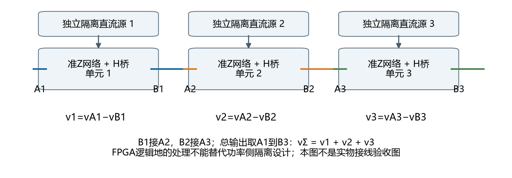
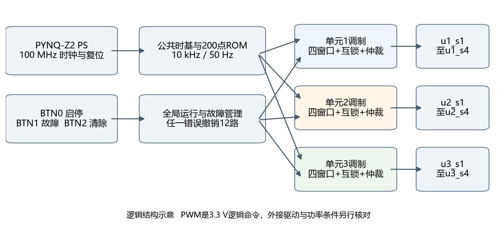
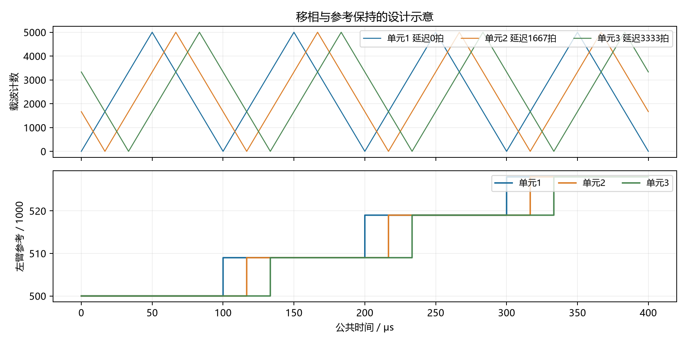
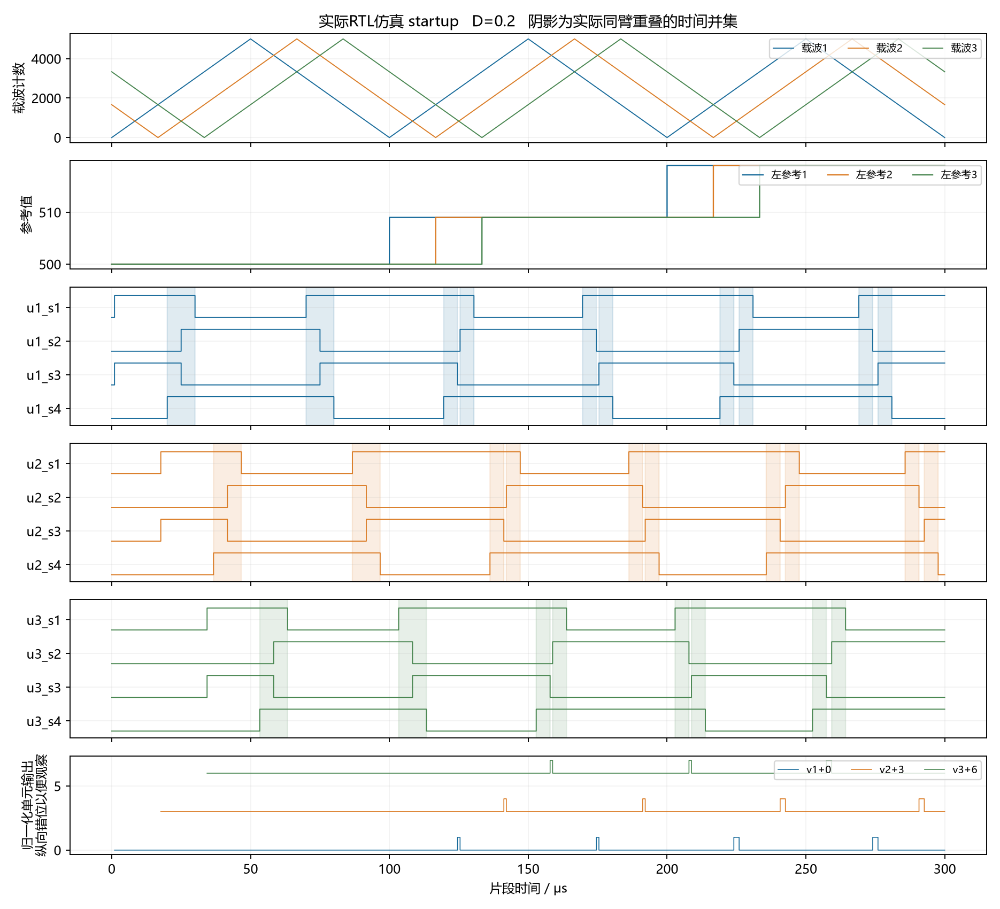
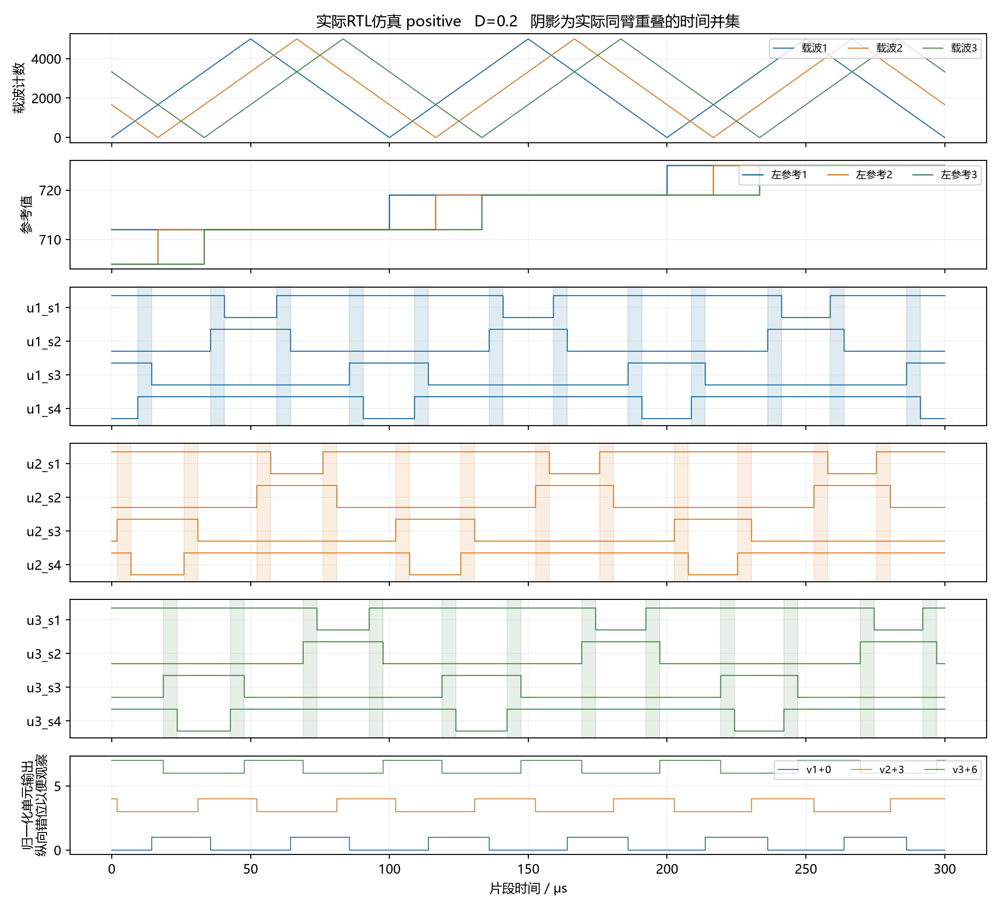
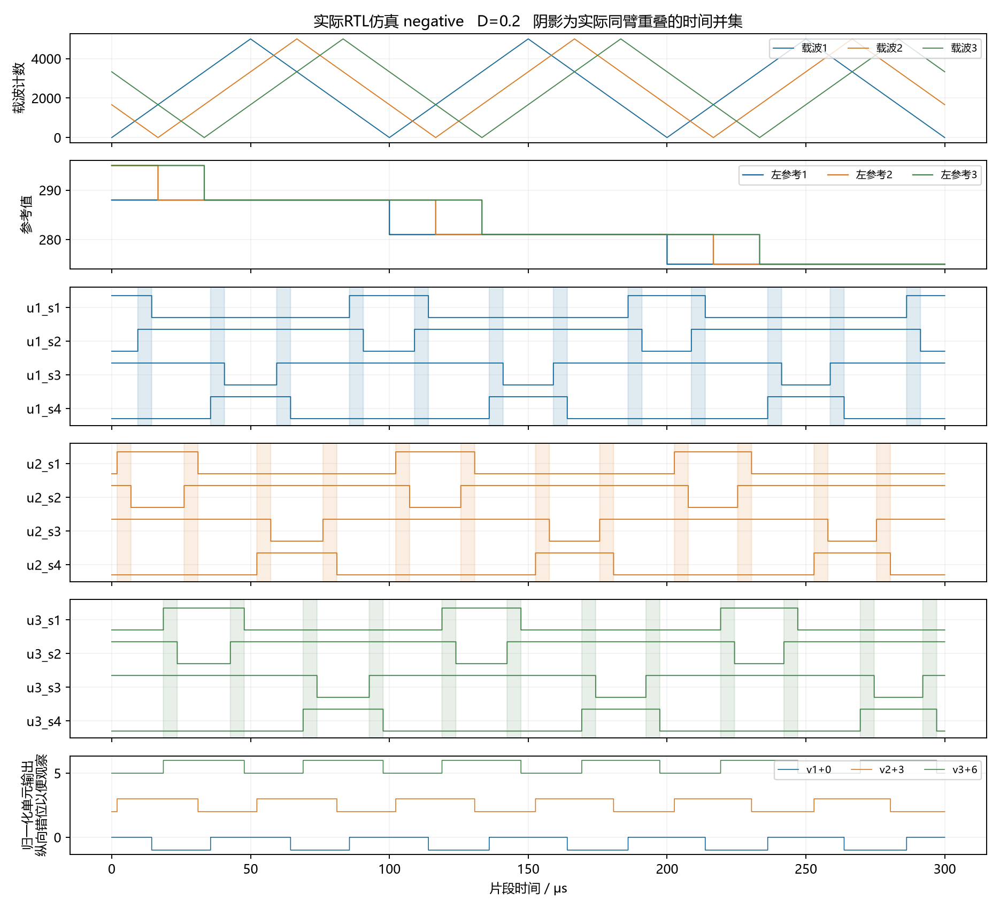
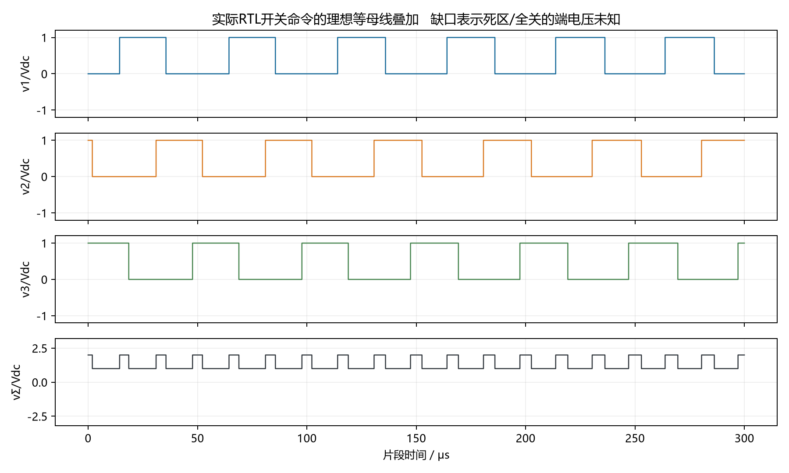

> 仓库文件说明：XPR、厂商 IP 文件、WDB 及主测试完整 key_trace.csv 由随附脚本在本地生成；结果文本、轻量统计、报告和图示可直接查看。

# 三模块级联准 Z 源开环控制工程概要设计

版本 CQZS 20261027 R1。本文帮助零基础使用者理解、打开、仿真和构建三单元工程。主工程固定 D1=D2=D3=0.2，基于 PYNQ-Z2，一块 FPGA 输出12路高有效逻辑命令。

本文说明 RTL 控制逻辑、仿真验证、两配置综合与实现结果，以及 D=0.2 位流参数。

工程根目录 P 指当前完整 three_qzs_open 文件夹（建议放在英文短路径）。后文相对路径均从 P 开始。整个 P 是交付单元，不能只复制一个 XPR。

每个单元的 H 桥输出定义为 vAB=vA−vB。按 B1接A2、B2接A3 的一致极性串联，输出取A1到B3，因此 vΣ=v1+v2+v3。各单元直流源及门极隔离必须支持浮动电位，不能把三个功率负母线随意接在一起。

每个单元 S1左上、S2左下、S3右上、S4右下；u1_s1至u3_s4正好对应12个逻辑命令。FPGA引脚不直接驱动功率管。本文的直通是受控调制状态，不是对现有驱动兼容性的确认。

<!-- page -->

## 模块连接与学习顺序

| 模块 | 主要输入 → 输出 | 作用 |
| --- | --- | --- |
| cascade_qzs_board_top | PS DDR/FIXED_IO、按键 → 12路PWM、LED | 板级顶层只连接BD与逻辑包装 |
| cascade_logic | 100MHz、复位、按键 → gates、LED | 复位同步、按钮控制与故障显示 |
| board_controls | 同步按键、故障锁存 → 启停请求/故障/清除 | 沿用同步、去抖、释放武装及优先级 |
| cascade_core | 启停/故障/清除 → 三单元命令 | 全局协调、故障来源记录、最终12路许可 |
| cascade_timebase / sine_ref_pair | 公共运行许可 → 相位/参考/索引 | 一个公共计数轴、一个200点ROM |
| cascade_unit ×3 | 局部相位、公共参考 → 单元四路 | 谷值锁存、载波寄存与启动等待 |
| qzs_window | 载波/保持参考 → 四窗口/向量 | 已验证的单单元窗口算法 |
| qzs_normal_interlock / qzs_gate_arbiter | 普通请求/ST → 白名单四路命令 | 普通换向等待、受控ST历史和统一仲裁 |

建议依次阅读参数文件、板级顶层、cascade_logic、cascade_core、cascade_unit，再读窗口和互锁。src/rtl/core及src/rtl/board中保留的旧单单元包装用于回归；正式sources_1只注册当前设计需要的文件。sim 中的文件用于测试，不进入综合。

<!-- page -->

## 固定参数与三单元移相依据

| 参数 | 本工程实际值 | 含义 |
| --- | --- | --- |
| 时钟 / 载波周期 | 100 MHz / 10000拍 | 1拍10 ns；Ts=100 μs，10 kHz |
| 参考表 / 基波 | 200点 / 50 Hz | 每100 μs推进一个样本，20 ms一轮 |
| 参考范围 / 调制度 | 200至800 / M=0.6 | 右参考=1000−左参考 |
| 主工程直通D | 200000 ppm = 0.2 | 每单元独立计算时间并集 |
| 普通换向死区 | 100拍 = 1 μs | 正常上下管换向先全关等待 |
| 按键去抖/故障释放 | 2000000拍 = 20 ms | 测试可缩短等待；板级值不缩短 |

关键参数入口为 src/rtl/cascade/cascade_config.vh。时钟、10000拍周期和200点表与继承模块绑定，是本阶段固定结构；不能只改一个数字就声称支持另一频率。D没有运行时接口，也没有PS通信配置框架。

论文《开关电感准Z源级联多电平光伏逆变器的研究》第3.2.1及3.2.2节明确给出模块载波互差180°/N，并描述左右桥臂参考互差180°、直通分四份插入开关时刻。N=3，因此采用60°间隔。用户已确认按该论文方案冻结。

| 单元 | 公共50Hz参考 | 载波延迟角 | 实际延迟时间 | 100MHz拍数 / 角误差 |
| --- | --- | --- | --- | --- |
| 1 | 0° | 0° | 0 μs | 0 / 0° |
| 2 | 0° | 60.012° | 16.67 μs | 1667 / +0.012° |
| 3 | 0° | 119.988° | 33.33 μs | 3333 / −0.012° |

理想60°对应1666⅔拍，120°对应3333⅓拍，故各自量化误差为±⅓拍，即±3.333 ns。两个相邻差为1667、1666拍；在单极性等效180°区间中第三间隔为1667拍。误差固定，不随运行时间累积。

三个单元没有120°基波相移。单元内部左参考为m、右参考为−m，对应本工程 ref_r=1000−ref_l，两臂共用该单元同一基础载波。另一等效普通SPWM表示可用相差180°的左右载波加相反比较极性；不能同时把参考和载波都翻转而不核对比较方向。

<!-- page -->

## 统一时间轴与参考保持

唯一公共相位计数器在0至9999循环。局部相位 p_i=(master_phase−delay_i) mod 10000。三个载波寄存器按该局部相位决定加1或减1，并在停机时预装对应初值0、1667、3333；它们没有自由运行使能。重新启动相位关系可重复。

公共ROM在master_phase=9999的时钟沿采用下一点。每单元在自己的p_i=0采样沿锁存公共参考与索引；该沿的比较仍使用先前保持值，下一拍起使用新值。谷值附近没有窗口或普通比较边界，因此不会移动半周期内的边界或截断直通。

从同一次公共ROM更新到单元采样，延迟分别为1、1668、3334拍；三个单元彼此相差0、1667、3333拍。它们采用同一个样本序列，保持边界有16.67 μs、33.33 μs的差，不是刻意设置基波相移。

50 Hz下额外保持延迟分别相当于0°、0.30006°、0.59994°。ROM相邻样本最大差10个参考计数；最坏在边界附近相差一个样本。相同幅值三路求和的固定延迟因子幅值为0.999990863，附加相位约−0.3°，不包含共同零阶保持延迟。集成测试逐拍核对所有保持索引与载波。

启动前参考有效、三个单元配置合法且都准备好，才给出全局许可。每个单元还等待自己的谷值后置started；第一个周期先经过普通开通等待，再进入完整窗口。最晚单元约33.34 μs后进入首帧。启动中的普通零状态开通有等待，不从中途窗口直接加上直通；测试统计包含各单元第一个完整周期。

<!-- page -->

## D等于0点2的四窗口定义

设左参考r，右参考1000−r，比较阈值qL=5r、qR=5(1000−r)。载波c从0升到5000再降到0。单窗口宽W=D×Ts/4=5 μs=500拍；每个单元一个完整载波周期内，任一桥臂上下管同时导通的时间并集为4W=2000拍=20 μs，所以D=0.2。不同单元之间的时间不能相加充当D。

| 参考条件 | 载波半开区间 | 受控桥臂 | S1 S2 S3 S4 |
| --- | --- | --- | --- |
| r≥500 | [qR−W, qR) | 右臂 | 1 0 1 1 |
| r≥500 | [qL, qL+W) | 左臂 | 1 1 0 1 |
| r<500 | [qL−W, qL) | 左臂 | 1 1 1 0 |
| r<500 | [qR, qR+W) | 右臂 | 0 1 1 1 |

每个区间在上行、下行各经过一次，合计四个带桥臂标签的窗口。r=500时每个半周期的两个标签窗相邻，时间并集合并成两个10 μs脉冲；总并集仍是20 μs，不能只数脉冲个数或重复计算重叠。逻辑禁止1111。

用单调局部相位p表示，a=min(qL,qR)、b=max(qL,qR)：上行低窗[a−W,a)，上行高窗[b,b+W)，下行高窗[10001−b−W,10001−b)，下行低窗[10001−a,10001−a+W)。10001来自离散三角波在下行跨越半开比较区间的端点。命令在采样沿后生效。

可行域检查：M+Dq+0.0008≤1；当前0.6+0.2+0.0008=0.8008≤1。等价边界为5REF_MIN≥W+2且5(1000−REF_MAX)≥W+2，即1000≥502，满足。原窗口模块还限定0≤D≤0.3、非零窗至少20拍；非法配置会拒绝运行并锁存故障，不静默修改D。

本次D=0.2量化正好为500拍，无D误差。沿用公式W=floor(ST_D_PPM/400)，一般量化向下，D误差小于0.0004。理论SL-QZSI升压分母1−2D−D²为正仅是理想稳态条件，不代表器件或驱动许可。

窗口相对参考阈值移动，位于普通零状态一侧；它们不是固定放在峰谷的简单升压窗口。各单元窗口随载波移相自然移动，允许由调制产生的单元间重叠，没有额外对齐或互斥规则。

<!-- page -->

## 互锁与启停故障过程

| 情形 | 输出行为 | 原因 |
| --- | --- | --- |
| 普通上下管换向 | 先两管全关，等待100个完整时钟 | 避免非预期同臂重叠 |
| 进入受控直通 | 只输出规定的三管白名单向量 | 直通有明确位置、宽度与桥臂 |
| 退出直通 | 保留原已导通器件的一个子集 | 不凭旧互锁历史额外重新开通 |
| 停机 / 复位 / 故障 | 最终全局许可撤销全部12路 | 普通及直通均没有绕行路径 |
| 任一单元参数/参考/仲裁错误 | 全局停机并记录单元来源 | 本阶段不旁路、不降级继续运行 |

普通死区是为换向而暂时全关；受控直通是准Z源阻抗网络所需的特定导通状态。两者语义不同。本工程保留普通死区，并在明确的ST状态下允许指定重叠，未以删除死区实现准Z源，也没有简单OR直通绕过关断。

| 按键 | 正常操作 | 防误触行为 |
| --- | --- | --- |
| BTN0 | 按一下启动，再按一下停止 | 同步、去抖、长按一次；必须先释放武装 |
| BTN1 | 按下模拟故障 | 同步后快速置故障，释放再稳定20ms |
| BTN2 | 按一下请求清除故障 | 源解除、停止后才清；清除不会启动 |

优先顺序为复位、故障源、清除事件、故障锁存抑制、启停事件。故障后board_controls取消启动请求；源解除后仍保持锁存，按清除后仍停机，必须释放并重新按BTN0。故障与启动同拍、清除与启动同拍，都不会自动运行。按住BTN0跨复位也不会启动。

fault_sources[0:2]保存单元1至3错误，bit3保存按钮模拟故障；多源可同时保留，至合法清除。故障时LED3:LED2显示按最小单元编号优先的来源码：01单元1、10单元2、11单元3、00按钮。它不是多源位图，完整位图留在寄存器和仿真中。

正常时LED0显示全局许可、LED1显示故障锁存、LED2显示已准备好、LED3显示许可后的首帧等待。等待仅约33 μs，肉眼通常看不到。全零命令不代表回路电流立即归零；按钮故障不能替代硬件过流与独立关断。

<!-- page -->

## 十二路接线与板级约束

| 信号名 | 对应功率管 | 连接器 / 物理脚 | FPGA管脚 | 电气标准 |
| --- | --- | --- | --- | --- |
| u1_s1 | 单元1 S1左上 | Pmod A / 1 | Y18 | LVCMOS33 |
| u1_s2 | 单元1 S2左下 | Pmod A / 2 | Y19 | LVCMOS33 |
| u1_s3 | 单元1 S3右上 | Pmod A / 3 | Y16 | LVCMOS33 |
| u1_s4 | 单元1 S4右下 | Pmod A / 4 | Y17 | LVCMOS33 |
| u2_s1 | 单元2 S1左上 | Pmod A / 7 | U18 | LVCMOS33 |
| u2_s2 | 单元2 S2左下 | Pmod A / 8 | U19 | LVCMOS33 |
| u2_s3 | 单元2 S3右上 | Pmod A / 9 | W18 | LVCMOS33 |
| u2_s4 | 单元2 S4右下 | Pmod A / 10 | W19 | LVCMOS33 |
| u3_s1 | 单元3 S1左上 | Pmod B / 1 | W14 | LVCMOS33 |
| u3_s2 | 单元3 S2左下 | Pmod B / 2 | Y14 | LVCMOS33 |
| u3_s3 | 单元3 S3右上 | Pmod B / 3 | T11 | LVCMOS33 |
| u3_s4 | 单元3 S4右下 | Pmod B / 4 | T10 | LVCMOS33 |

12路均设置DRIVE=8 mA、SLEW=SLOW，以限制不必要的边沿速度；这只是FPGA IO设置，不是门极驱动能力。Pmod A/B的5、11为地，6、12为3.3V电源，不作为PWM。Pmod B其余信号脚未使用。物理脚号以手册和板上1脚标记为准，不按观察方向猜编号。

Pmod A全部8个信号与Raspberry Pi排针共享，不能同时接另一设备驱动这些网络。手册v1.1表14中B第8脚写成W156；官方XDC给出W16，此处按疑似笔误记录，本工程不使用该脚。

| 板上资源 | 封装管脚 | 用途 |
| --- | --- | --- |
| BTN0 / BTN1 / BTN2 | D19 / D20 / L20 | 启停 / 模拟故障 / 清除 |
| LED0 / LED1 | R14 / P14 | 运行 / 故障 |
| LED2 / LED3 | N16 / M14 | 准备/首帧；故障时为来源码 |

引脚依据：本地PYNQ_Z2_User_Manual_v1.1.pdf表9、11、13、14及第18节；官方Xilinx/PYNQ v3.1.2的boards/Pynq-Z2/base/vivado/constraints/base.xdc。XDC只对异步按键到第一级同步器D端设置精确例外，第二级同步路径仍计时。PS IP提供唯一100MHz时钟约束。

<!-- page -->

## 启动与零交越的十二路实际波形

蓝、橙、绿分别是单元1、2、3。每组从上到下为S1、S2、S3、S4；浅色阴影表示从实际四路命令计算的同臂重叠并集。首帧从各自谷值进入，移相保持不变。r=500时相邻标签窗合并，计时仍为每周期2000拍。

图内载波、参考和12路命令均来自key_trace.csv。底部是对实际命令应用等母线理想开关状态映射的结果，纵向错开便于比较；这不是门极测量或准Z源升压电压仿真。

<!-- page -->

## 正半周的十二路实际波形

相邻单元的载波谷值相差约16.67 μs，保持参考的更新也依次错开。每个单元的四路必须按它自己的完整载波周期统计，不能用同一张图的左右裁剪边缘直接当作所有单元周期边界。

正半周窗口向量为1011和1101。窗口之外的普通换向仍由互锁模块等待。WDB中同时保留运行、故障、来源位和窗口信号，便于放大边界；预置WCFG已按u1_s1至u3_s4命名12路。

<!-- page -->

## 负半周的十二路实际波形

负半周窗口向量为1110和0111，左右桥臂标签随参考符号改变。窗口仍是4份500拍；不能把参考正负变化理解为要交换实物S1至S4线序。

主测试在三个单元、四个窗口的开始前、开始、中间和结束位置，分别注入停机、同步逻辑故障及异步复位，合计144例。中断允许立即截短命令，不为保持窗宽而延迟关断。原始注入记录在interruption_cases.csv。

<!-- page -->

## 理想开关状态叠加与七电平能力

| 单元命令 S1S2S3S4 | 归一化电压 | 模型假设 |
| --- | --- | --- |
| 1001 / 0110 | +1 / −1 | 理想等幅非直通母线Vdc |
| 1010 / 0101 | 0 | 完整普通零矢量 |
| 四种三管直通向量 | 0 | 理想准Z源直通短接桥输出 |
| 0000或单管状态 | 未知 | 端电压取决于电流/二极管，图中留缺口 |

有效单元状态−1、0、+1的27种组合求和可得到−3、−2、−1、0、1、2、3，七电平能力检查通过。当前M=0.6的实际调制记录只有−2至+2五个有效电平；不把状态组合的七电平能力说成当前运行波形已出现全部七电平。

模型没有电感、电容、损耗、二极管动态、器件应力、母线纹波或升压过程。未知状态不能随意当作零电压，更不能把这里的归一化叠加图当成功率电路或升压实测。

<!-- page -->

## 测试结果与可追溯证据

| 测试组 | 结果 | 检查数 | 覆盖摘要 |
| --- | --- | --- | --- |
| cascade_main | PASS | 64280717 | 570/546/522周期；148次启动；144中断；3单元错误 |
| cascade_d0 | PASS | 40243646 | 每单元402周期；无直通 |
| cascade_buttons | PASS | 20 | 抖动、长按、跨复位、优先级、3路来源LED |
| cascade_parameters | PASS | 6 | 6种非法配置全部拒绝 |
| qzs | PASS | 170516994 | 单单元相关回归，详见同名result |
| normal_spwm | PASS | 36687682 | 单单元相关回归，详见同名result |
| interlock | PASS | 10947 | 单单元相关回归，详见同名result |
| arbiter | PASS | 262145 | 单单元相关回归，详见同名result |
| parameter | PASS | 40023 | 单单元相关回归，详见同名result |
| qzs_board | PASS | 240041 | 单单元相关回归，详见同名result |
| board | PASS | 240041 | 单单元相关回归，详见同名result |
| core | PASS | 65522879 | 单单元相关回归，详见同名result |
| deadtime | PASS | 3 × 17011 | 单单元相关回归，详见同名result |
| compare | PASS | 20128 | 单单元相关回归，详见同名result |
| reset | PASS | 见原日志 | 单单元相关回归，详见同名result |
| equivalence | PASS | 16780300 | 单单元相关回归，详见同名result |
| trace | PASS | 见原日志 | 单单元相关回归，详见同名result |

主集成连续覆盖40.24 ms以上，超过两个完整50Hz周期。每拍完整12位输出与独立事件/换向等待模型比较；载波、参考索引是被检查量，不作为期望答案。逐周期CSV分别记录三个单元的并集、左右臂时间和四标签窗。

继承回归在新目录实际重新运行：包括窗口参数边界、普通SPWM、受控互锁、仲裁全组合、参考异常、旧D0与H桥逐拍对照、按键和实际proc_sys_reset IP。新级联D0使用同一受控互锁的无ST分支，与旧D0流水延迟不同，不能用旧单单元等价结果冒充新级联逐拍等价。

原始证据位于sim/results/各测试名，含编译、展开、simulate.log、result、WDB及CSV。按键加速测试使用8拍等待，真实100MHz及100拍死区不缩短。没有形式证明、任意SEU覆盖或硬件按键延迟测量。

<!-- page -->

## 综合实现结果与保留告警

| D | 阶段 | WNS ns | TNS ns | WHS ns | LUT | FF |
| --- | --- | --- | --- | --- | --- | --- |
| 0.2 | 综合估计 | 1.408 | 0.000 | 0.045 | 见原报告 | 见原报告 |
| 0.2 | 布局布线后 | 1.058 | 0.000 | 0.118 | 829 | 367 |
| 0 | 综合估计 | 1.221 | 0.000 | 0.045 | 见原报告 | 见原报告 |
| 0 | 布局布线后 | 1.494 | 0.000 | 0.047 | 545 | 343 |

器件xc7z020clg400-1，Vivado 2025.2 Build 6299465。两配置均仅有一个100MHz内部时钟；实现DRC默认规则0项违例，CDC为3项CDC-3 Info（双级ASYNC_REG同步按键）。无黑盒、锁存器、内部未约束端点、无时钟寄存器、组合环或多时钟端点。BRAM为0，200字MEM读取成功，ROM映射到LUT。

真实方法学告警保留：TIMING-18共16项，来自12路PWM和4路LED没有外部接收器时序规格；未编造output_delay。三个按键只在异步入口有精确例外，没有放宽内部路径。报告的时序通过指已约束内部路径，不等于驱动端时序签核。

另保留1项LUTAR-1：继承BD中的reset_guard把PS原始低有效复位与proc_sys_reset延迟释放做AND，送入板级异步置位/同步释放链。方法学工具提示LUT异步复位可能有毛刺；复位IP及RTL回归覆盖了预定断言与释放时序，但没有实板毛刺测量，不声称消除此类物理风险。

首轮非寄存载波实现WNS=−0.164 ns，未生成位流。最终将单元载波按公共相位方向寄存更新，保持逐拍行为，主集成及D0、按键、非法配置均重新通过；最终实现WNS=1.058 ns。旧失败报告放在reports/pre_carrier_register，仅作优化记录。没有改变M、D、死区或放宽时钟约束。

主位流为board/bitstream/cascade_qzs_d020.bit，配套同名HWH。Vivado原输出为project_main/cascade_qzs.runs/impl_1/cascade_qzs_board_top.bit。D0完成实现，仅作对照，不单独交付位流。

<!-- page -->

## 按Vivado界面打开仿真和构建

1 选择Vivado的Open Project，打开 P/board/project_main/cascade_qzs.xpr。真实顶层应显示cascade_qzs_board_top，器件xc7z020clg400-1。Sources中打开src/rtl/cascade/cascade_config.vh，QZS_MAIN_D_PPM=200000就是D=0.2；工程不使用脚本或XPR generic偷偷覆盖这个值。

2 在Sources切到Simulation Sources。主仿真集为sim_main，顶层cascade_main_tb。右键仿真集选择Make Active，再在Flow Navigator选择Run Simulation、Run Behavioral Simulation。波形打开后点击Run All，运行到测试台自行结束；可用Zoom Fit查看全程，再放大100 μs的载波周期。

3 已预设sim_d0、sim_buttons、sim_parameters，分别用于D0、按键与非法参数。选择对应仿真集并Make Active即可，不需要改源文件或参数。主工程的仿真顶层与板级综合顶层各自独立。

4 若只看已经完成的波形，选择File、Open Waveform，打开sim/results/cascade_main/cascade_main.wdb；再用Open Waveform Configuration打开sim/cascade_main.wcfg。预置42行包含12个明确命名的PWM位、三载波、参考、窗口、运行与故障。其他测试同理使用同名WDB/WCFG。

5 在Flow Navigator依次点击Run Synthesis、Run Implementation。修改设计后Vivado若提示Reset Runs，确认重跑。完成后Open Implemented Design，在Reports中查看Timing Summary、DRC、Clock、CDC、Utilization。保持10 ns时钟和当前XDC，不通过修改约束掩盖失败。

6 在实现及检查通过后点击Generate Bitstream。正常输出位于board/project_main/cascade_qzs.runs/impl_1。board/bitstream是保存副本，今后GUI重建不会自动更新该冻结副本或旧校验清单。不要把旧报告当成改后代码的新结论。

7 D0对照工程独立位于P/board/project_d0/cascade_qzs.xpr，顶层cascade_qzs_d0_board_top，内部固定ST_D_PPM=0。打开D0不改变主工程。两套工程只共享包内源码、MEM与约束，各自拥有完整BD和生成文件。

8 PS 提供 FCLK，逻辑运行使用 PS 初始化、100 MHz 时钟与板级复位链。BD 预设、ps7_init 与 HWH 文件见 board 目录。

目录：rtl为设计及继承回归依赖；constraints为板级XDC；board_files为PS预设；project_main/project_d0为正式XPR与BD；verification为测试和真实运行结果；scripts为维护者可选重建工具；handoff为说明、接线、图、报告、位流和版本审计。用户日常使用无需修改任何脚本。

<!-- page -->

## 来源与实现差异

源码来源为D:/work/fpga_contest/single_open/single_qzs_open当前实际文件。先读了handoff/README，再核对10月26日D0.2完成记录、当前源码及结果；旧10月20日交接快照属于历史。当前旧source_manifest有5个条目与实际文件不符，已将实际SHA256及差异保存到audit，不使用旧PASS替代本次回归。原工程、普通H桥工程及原资料未修改。

| 内容 | 实现处理 | 验证/依据 |
| --- | --- | --- |
| 窗口、仲裁、ROM、按键事件、同步/复位、运行管理 | 复用当前文件；按键模块连接改为具名端口 | 13组继承回归；reuse_manifest记录来源 |
| 互锁状态常量 | 十进制截断写法改为6位显式二进制 | 互锁100/1/2拍等回归通过；外部行为模型通过 |
| 时间基准与载波 | 提取公共周期相位；每单元载波由共同相位决定方向 | 三载波逐拍核对，超过两个基波无漂移 |
| 单元组合 | 一个cascade_unit例化3次 | 全12位独立模型、窗口计时、首帧、重启 |
| 全局故障 | 任一错误关闭12路、保留来源，LED编码 | 144中断、3核心错误、3板级来源例 |
| D0路径 | 同一互锁无ST分支，比较直接采样 | 独立普通模型；不声称与旧D0流水逐拍相同 |

调制采用共同基波参考与三个局部载波，相邻载波延迟约 60°；参数与实现方法见设计说明。
